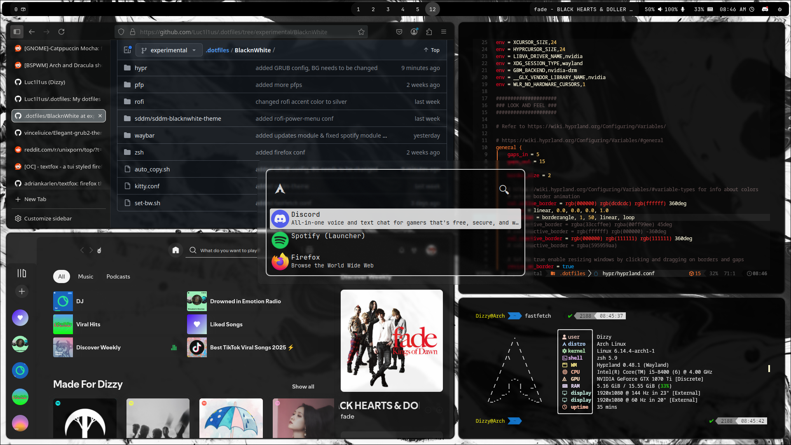

# Black and White or Monochrome

Arch  


Windows  
.png)

# For Arch Linux
Execute the following command:
```
./set-bw.sh
```

# For Windows
Execute the following command:
```
./set-bw.ps1
```

### For Firefox config
~~Replace [your_profile_directory] with your actual profile directory. Please see your profile by inputting this into the address bar `about:profiles` and copy & paste the root directory of the profile in use.~~

Please see your profile by inputting this into the address bar `about:profiles` and take note of the profile in use as it will be later on used in the installation script.

### Themes yoinked/copied from
[Discord](https://github.com/refact0r/system24)  
[Spotify](https://github.com/AvinashReddy3108/spicetify-tui)
[GRUB](https://github.com/vinceliuice/Elegant-grub2-themes)